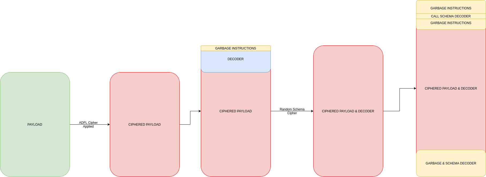

# SGN


<div align="center">
  
  <br>
  <br>


  [![GitHub All Releases][release-img]][release]
  [![Build][workflow-img]][workflow]
  [![Issues][issues-img]][issues]
  [![Crates][crates-img]][crates]
  [![License: MIT][license-img]][license]
</div>

[crates]: https://crates.io/crates/sgn
[crates-img]: https://img.shields.io/crates/v/sgn
[release]: https://github.com/EgeBalci/sgn/releases
[release-img]: https://img.shields.io/github/v/release/EgeBalci/sgn
[downloads]: https://github.com/EgeBalci/sgn/releases
[downloads-img]: https://img.shields.io/github/downloads/EgeBalci/sgn/total?logo=github
[issues]: https://github.com/EgeBalci/sgn/issues
[issues-img]: https://img.shields.io/github/issues/EgeBalci/sgn?color=red
[license]: https://raw.githubusercontent.com/EgeBalci/sgn/master/LICENSE
[license-img]: https://img.shields.io/github/license/EgeBalci/sgn.svg
[google-cloud-shell]: https://console.cloud.google.com/cloudshell/open?git_repo=https://github.com/EgeBalci/sgn&tutorial=README.md
[workflow-img]: https://github.com/EgeBalci/sgn/actions/workflows/main.yml/badge.svg
[workflow]: https://github.com/EgeBalci/sgn/actions/workflows/main.yml
[fe-article]: https://www.fireeye.com/blog/threat-research/2019/10/shikata-ga-nai-encoder-still-going-strong.html
[lfsr]: https://en.wikipedia.org/wiki/Linear-feedback_shift_register


SGN is a polymorphic binary encoder for offensive security purposes such as generating statically undetecable binary payloads. It uses a additive feedback loop to encode given binary instructions similar to [LFSR][lfsr]. This project is the reimplementation of the [original Shikata ga nai](https://github.com/rapid7/metasploit-framework/blob/master/modules/encoders/x86/shikata_ga_nai.rb) in golang with many improvements. 


> [!WARNING]  
> The project recently ported to Rust. This port keeps the original design and behaviour but replaces the [keystone](https://www.keystone-engine.org/) text assembler with the pure-Rust [`iced-x86`](https://docs.rs/iced-x86) assembler, so **there are no native library dependencies** — it builds with a plain `cargo build`. Check out the [sgn-go](https://github.com/EgeBalci/amber/tree/sgn-go) branch for legacy Go version.


## Why?
For offensive security community, the original implementation of shikata ga nai encoder is considered to be the best shellcode encoder(until now). But over the years security researchers found several pitfalls for statically detecing the decoder stub(related work [FireEye article][fe-article]). The main motive for this project was to create a better encoder that encodes the given binary to the point it is identical with totally random data and not possible to detect the presence of a decoder. 

- [x] 64 bit support. `Finally properly encoded x64 shellcodes !`
- [x] New smaller decoder stub. `LFSR key reduced to 1 byte`
- [x] Encoded stub with pseudo random schema. `Decoder stub is also encoded with a psudo random schema`
- [x] No visible loop condition `Stub decodes itself WITHOUT using any loop conditions !!` 
- [x] Decoder stub obfuscation. `Random garbage instruction generator added with keystone`
- [x] Safe register option. `Non of the registers are clobbered (optional preable, may reduce polimorphism)` 

## How it works

Each encoding pass:

1. (optional) appends a register-restore suffix (safe mode);
2. prepends random, value-preserving garbage instructions;
3. ciphers the payload with the **ADFL** (additive feedback loop) cipher and
   prepends a loop-free decoder stub that reverses it at runtime;
4. unless `--plain`, encrypts the stub itself with a random per-run **schema
   cipher** (`XOR/ADD/SUB/ROL/ROR/NOT` over DWORDs) and prepends a self-locating
   schema decoder, so even the decoder looks like random data;
5. optionally repeats `--enc` times with fresh seeds;
6. (optional) prepends a register-save prefix (safe mode).

## Install
```sh
cargo install sgn
```
You can also get the pre-compiled binaries [HERE][release]. 

**Usage**

`-h` is pretty self explanatory use `-v` if you want to see what's going on behind the scenes `( ͡° ͜ʖ ͡°)_/¯`
<p align="center">
  
</p>


```
       __   _ __        __                               _ 
  ___ / /  (_) /_____ _/ /____ _  ___ ____ _  ___  ___ _(_)
 (_-</ _ \/ /  '_/ _ `/ __/ _ `/ / _ `/ _ `/ / _ \/ _ `/ / 
/___/_//_/_/_/\_\\_,_/\__/\_,_/  \_, /\_,_/ /_//_/\_,_/_/  
========[Author:-Ege-Balcı-]====/___/=======v2.0.2=========  
    ┻━┻ ︵ヽ(`Д´)ﾉ︵ ┻━┻           (ノ ゜Д゜)ノ ︵ 仕方がない

sgn [OPTIONS]

Options:
  -i, --input <INPUT>        Input binary path
  -o, --out <OUT>            Encoded output binary name (default: <input>.sgn)
  -a, --arch <ARCH>          Binary architecture (32/64) [default: 64]
  -c, --enc <ENC>            Number of times to encode the binary [default: 1]
  -M, --max <MAX>            Maximum bytes per garbage block [default: 50]
      --plain                Do not encode the decoder stub
      --ascii                Generate a fully ASCII-printable payload (slow)
  -S, --safe                 Preserve all register values (no clobber)
      --badchars <BADCHARS>  Avoid these bytes, hex format (e.g. \x00\x0a)
  -v, --verbose              Verbose mode
  -h, --help                 Print help
  -V, --version              Print version

```

Example:

```sh
sgn -i shellcode.bin -o encoded.bin -a 64 --badchars '\x00\x0a\x0d'
```

## Execution Flow

The following image is a basic workflow diagram for the encoder. But keep in mind that the sizes, locations and orders will change for garbage instructions, decoders and schema decoders on each iteration. 

<p align="center">
  
</p>

LFSR itself is pretty powerful in terms of probability space. For even more polimorphism garbage instructions are appended at the begining of the unencoded raw payload. Below image shows the the companion matrix of the characteristic polynomial of the LFSR and denoting the seed as a column vector, the state of the register in Fibonacci configuration after k steps.

<p align="center">
  
</p>


## Using as a library

```rust
use sgn::Encoder;

let shellcode = std::fs::read("payload.bin")?;
let mut encoder = sgn::Encoder::new(64)?;
let encoded = encoder.encode(&shellcode)?;
println!("encoded {} bytes", encoded.len());
```

See `examples/encode_binary.rs`.

## Testing

```sh
cargo test
```

The suite includes cipher round-trip unit tests plus **real execution tests**:
encoded x64 shellcode is mapped executable and run in-process, and x86 shellcode
is executed via a `cc -m32` helper harness (skipped automatically if no 32-bit
toolchain is present). Both architectures are exercised across the plain,
schema, multi-layer and safe-register modes, including a randomized stress loop.

## Notes on the port

* Instruction generation uses `iced-x86`'s typed assembler API rather than
  keystone assembly text; the decoder stubs were rebuilt around RIP-relative
  addressing (x64) and a `call/pop` two-pass scheme (x86).
* The schema cipher is expressed directly in the CPU's native little-endian
  DWORD view, which is equivalent to but clearer than the original's mixed
  big/little-endian arithmetic.
* Dead code from the original (the unused ~3k-line instruction-set table and the
  "unsafe garbage" generator that nothing called) was dropped.
* Minor fixes: `random_byte` now spans the full `0..=255` range, and the
  garbage-size budget (`--max`) is applied consistently as a per-block cap.